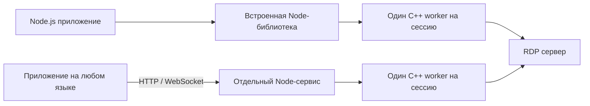

# Варианты поставки после 0.2.0

2026-10-22. Рабочее предложение для обсуждения, не принятый ADR и не заявление
о готовности новых пакетов. По решению пользователя развитие функциональности
останавливается на стабильной 0.2.0 до выбора способов поставки. Нормативные
требования, ограничения MVP и незавершённые пункты TODO сохраняются.
Пользователь отдельно выбрал **Fastify** как первый сервер для npm-встраивания.
Последующее решение пользователя: Fastify выпускается как **0.2.1** и развивается
в отдельной ветке `feature/fastify-0.2.1`. Каждый следующий принятый вариант
распространения увеличивает последнее число `0.2.x`: 0.2.2, 0.2.3 и далее.
Выбор Fastify и эта нумерация — решения пользователя; конкретные API и
техническое устройство следующих пакетов ниже остаются предложением.

Последующее уточнение пользователя задаёт весь первый набор адаптеров:
**0.2.1 Fastify → 0.2.2 NestJS → 0.2.3 встроенный `node:http` → 0.2.4 Express**.
Последнее решение добавляет Express к ранее выбранным трём адаптерам. Это порядок будущей разработки,
а не заявление о готовности. Fastify реализуется в отдельной ветке:
[текущий контракт и открытая приёмка](FASTIFY_PLUGIN.md). Следующие адаптеры
начинаются после приёмки предыдущего, каждый в своей ветке.

## Рекомендация

Поддерживать одно ядро и два способа его использования:

1. **npm runtime для Node.js-приложений.** Приложение импортирует сущности,
   подключает RDP HTTP/WS к своему существующему web-server на том же порту,
   управляет сессиями и запускает локальные native workers.
2. **Самостоятельный сервис.** Тот же Node-слой и те же workers поставляются
   вместе с частным Node.js runtime; приложения обращаются через HTTP/WebSocket.
   Архивы, DEB/RPM, MSI и контейнер являются упаковками этого сервиса.

Дополнительно может понадобиться небольшой **npm HTTP-клиент** к отдельному
сервису. Он не запускает RDP у себя. Его нельзя выдавать за npm runtime:
место работы worker, доступные устройства и ответственность за эксплуатацию
у этих вариантов различаются.



FreeRDP всегда находится в отдельном процессе. Linux `rdp-ipc.node` обслуживает
только IPC; это не загрузка FreeRDP внутрь Node. Формат поставки не меняет
протоколы, правила сертификатов, ограниченные очереди и передачу секретов по IPC.

## Что имеется в 0.2.0

| Компонент | Фактическое состояние |
| --- | --- |
| `@freerdp-bridge/node` | ESM и TypeScript declarations; экспортирует `SessionManager`, `NativeSessionWorker`, `WorkerProcess`. Требует явно заданных `workerPath` и `runtimeRoot`; автоматической установки native runtime нет. |
| `@freerdp-bridge/config`, `@freerdp-bridge/protocol` | Отдельные workspace-пакеты. Для внешнего потребителя нужны корректно упакованные и доступные зависимости. |
| HTTP API | `apps/bridge-api` имеет `private: true`; штатного публичного npm server-пакета сейчас нет. Фабрика `createSessionServer` используется внутри проекта. |
| Native архивы | Подготовлены Linux x64 TGZ и Windows x64 ZIP с частными библиотеками, лицензиями и метаданными; хеши и область приёмки в [418](ITERATION_418.md). Это не установщики полного приложения. |
| Node архив | Linux production deployment, полученный `pnpm deploy --prod`; это не результат `npm pack` библиотечного пакета. |
| OCI/Docker | Есть сборка сервиса из архивов и исторические проверки ограниченного runtime. Новый контейнер именно 0.2.0 требует своей приёмки; старый образ не становится новым релизом от смены манифеста. |
| MSI/EXE/DEB/RPM | Есть заготовки CPack. Установка, служба, обновление, откат и удаление полного сервиса не приняты. |
| Публикация | Локальный Git tag и архивы не означают публикацию в npm, реестре контейнеров или внешнем хостинге. |

Компилятор GCC 8.3 и реальный RDP к Astra 1.7.5/RED OS 7.3 имеют отдельные
[подтверждения](ITERATION_417.md). Это не приёмка всех возможных профилей
установленной ОС, её средств защиты или устройств. Windows listening/input
MVP сохраняет свою [историческую область](MVP_ACCEPTANCE.md); новый формат
поставки должен повторить соответствующую проверку.

## Сравнение форматов

| Формат | Как работает | Что получает пользователь | Ограничения и цена поддержки |
| --- | --- | --- | --- |
| npm runtime | JS-библиотека в Node-приложении, workers рядом с ним | Прямое управление из TypeScript/JS, своя авторизация и маршруты | Node.js 24 у потребителя; native комплект под ОС/CPU/libc; приложение отвечает за shutdown, лимиты и эксплуатацию |
| npm HTTP-клиент | Соединяется с установленным сервисом | Небольшой пакет; native зависимости остаются на сервере | Нужен сервис; сетевые ошибки/задержки; устройства доступны на сервере, а не на машине SDK |
| Portable TGZ/ZIP сервиса | Распаковать комплект Node + JS + native и запустить launcher | Работа без сборки и без глобальной установки Node | Автозапуск, учётная запись, права, HTTPS и обновления требуют настройки |
| DEB для Astra/поддержанных Debian-систем | Тот же сервис, системная установка и unit | Управление службой и файлами штатными средствами ОС | Отдельные проверки каждого дистрибутива, зависимостей, политик защиты, обновления и удаления |
| RPM для RED OS | Тот же сервис, RPM и unit | Удобное серверное развёртывание на RED OS | Не считать совместимым любой RPM-дистрибутив без проверки |
| MSI для Windows | Частный runtime и служба под выделенной учётной записью | Установка, ремонт, обновление и удаление через installer | Нужны service host, ACL, проверка остановки workers и подписывание; служба имеет иной контекст устройств |
| EXE installer | Возможный bootstrapper поверх MSI/того же runtime | Один привычный файл для установки | Второй механизм обновлений не нужен; добавляет сборочную/подписную матрицу и проверки |
| OCI-контейнер Linux | Сервис и native внутри образа | Повторяемое развёртывание, удобные лимиты и откат по digest | Доступ к host devices только по явной политике и mappings; архитектура/kernel/libc не исчезают |
| Node SEA, «один exe» | Node с упакованным JS | Меньше видимых JS-файлов | Worker и DSOs всё равно нужны как реальные исполняемые файлы; потребуется изменение загрузки модулей и отдельная приёмка |

Практический первый набор: **npm runtime + portable service TGZ/ZIP**.
Для описанного пользователем npm сценария runtime должен включать принятый
server adapter для общего порта и документированную browser-интеграцию;
одной публикации нынешних JS tarball для этого недостаточно.
После их приёмки — **DEB для Astra, RPM для RED OS, MSI для Windows**.
Контейнер использует тот же проверенный комплект. Отдельный EXE bootstrapper
и SEA имеют смысл после появления конкретной потребности.

## npm и существующий web-server: один порт

Уточнение пользователя: нужен импортируемый модуль, который встраивается
в существующий Node.js web-server, принимает настройки RDP, отдаёт изображение
и диагностику. Это основная целевая интеграция npm runtime. Пользовательское
приложение должно владеть `listen()`, TLS и своим HTTP/WS router; библиотека
не открывает второй порт и не закрывает чужой server при своём `close()`.

Пример проектного размещения на `https://app.example`:

| Путь на одном порту 443 | Назначение |
| --- | --- |
| `/api/...`, `/app-ws` | Существующие маршруты и WebSocket приложения |
| `/rdp/v1/sessions` | Создать сессию из валидированных настроек под identity приложения |
| `/rdp/v1/sessions/:id/attach-token` | Короткоживущие права подключения к конкретной сессии |
| `/rdp/v1/sessions/:id/control` | WebSocket: lifecycle, input, cursor/display, certificate decision и согласованная диагностика |
| `/rdp/v1/sessions/:id/media` | WebSocket: бинарные JPEG/H.264/audio и ограниченный feedback |
| `/rdp/v1/build`, `/rdp/v1/capabilities` | Сборка и реально доступные возможности |
| `/rdp/metrics` | Защищённые агрегированные метрики; не общий дамп сессионных данных |

Это **проектный prefix**, не работающие сейчас `/rdp` endpoints. В 0.2.0
`createSessionServer()` создаёт собственный Fastify instance, маршруты имеют
жёсткий `/v1`, а `installSessionWebSockets()` подписывается на весь `upgrade`
и отвечает 404 на чужой WS path. Поэтому просто импортировать текущий файл
и добавить его к любому приложению недостаточно: это может закрыть WebSocket
самого приложения. Глобальные error/not-found handlers, `maxConnections`
и shutdown hooks также нужно отделить от локальных правил bridge.
Health/readiness и metrics должны иметь согласованные пути/registry и не
переписывать существующие `/healthz`, `/readyz` или `/metrics` приложения.

Предлагаемый будущий контракт — engine с session entities и адаптер подключения
к HTTP/framework. Например, `createBridge(...)` возвращает управляемый экземпляр,
plugin регистрирует HTTP-маршруты с prefix, а host upgrade router передаёт bridge
только принадлежащие ему запросы. **Эти имена иллюстративны; exports 0.2.0 их
не содержат.** Пользователь выбрал первый адаптер для **Fastify**, затем
**NestJS**, **встроенный `node:http`**, затем **Express 0.2.4** по последнему
уточнению пользователя. Поддержанные HTTP adapters самого NestJS нужно явно
определить и проверить при его реализации. Для каждого адаптера нужны полные
руководства применения в реальных проектах в `docs/` в формате Markdown.

Иллюстрация будущего использования, не исполняемый пример 0.2.0:

```ts
import { rdpBridgePlugin } from '@freerdp-bridge/node'; // proposed export

await app.register(rdpBridgePlugin, {
  prefix: '/rdp',
  worker: verifiedRuntimeOptions, // trusted native path + private runtime root
  authenticate: authenticateApplicationRequest,
  allowedOrigins: ['https://app.example'],
});
// Existing app owns app.listen(), TLS and other HTTP/WS routes.
```

Первый профиль приёмки — Fastify 5 / Node.js 24, HTTP/1.1 с WS/WSS;
HTTP/2-only, другие major Fastify и другие Node major требуют отдельного scope.
Plugin должен сохранять encapsulation routes/hooks и штатный prefix Fastify.
[Модель plugins](https://fastify.dev/docs/latest/Reference/Plugins/),
[encapsulation](https://fastify.dev/docs/latest/Reference/Encapsulation/).
Нужно выбрать и проверить одну композицию с host WS router: например, согласованный
`@fastify/websocket` или единый explicit upgrade dispatcher. Версия WS plugin,
порядок регистрации и поведение на чужих routes должны быть частью поддержанного
контракта. Его наличие не проверено текущей 0.2.0 и зависимость сейчас не добавляется.
[Официальный Fastify WebSocket plugin](https://github.com/fastify/fastify-websocket).

Один центральный upgrade router должен выбрать ровно одного владельца socket.
Неизвестный bridge путь вне его prefix передаётся приложению без чтения body,
проверки токена, изменения socket или ответа. Внутри prefix действует обычный
отказ для неверного route/token/Origin/subprotocol. Нельзя вызывать
`removeAllListeners('upgrade')` или переопределять маршруты/логирование host.
Shutdown bridge снимает только свои handlers, дренирует только свои сессии
и не закрывает общий listener. В standalone тот же engine принадлежит bootstrap,
который уже сам создаёт и закрывает сервер.

Настройки можно скрыть за удобным browser API вида `connect(config)`: он создаёт
сессию по HTTP и подключает существующие control/media WS. Несколько WebSocket
соединений работают на одном порту. Сохранение двух каналов сохраняет отдельные
media credit/backpressure и управляющие сообщения. Если нужен именно один WS,
включая создание сессии и multiplex media/control, это отдельный новый wire
контракт с собственной приёмкой; упаковка npm сама его не реализует.

Для «показа картинки» нужен ещё browser client: decoder/canvas, local cursor,
input и при необходимости audio/Clipboard UI. Серверный npm runtime отдаёт
байты и события. Следует оформить browser exports либо отдельный web-пакет
из reference client, чтобы интегратор подключал view в своё приложение.
Готовый login/profile UI не является обязательной частью такого компонента.

Диагностику разделить на пользовательское состояние сессии и operator telemetry.
Состояния/ошибки уже передаются по control, агрегаты существуют в `/metrics`,
а private pipeline counters не являются автоматически публичным diagnostics
stream. Для новых счётчиков потребуется согласованная схема, capability/version
negotiation, разрешения владельца сессии, ограниченная частота и latest-only
буфер. Такие обновления можно передавать по control с меньшим приоритетом,
не вытесняя certificate/input/lifecycle. Desktop/Clipboard/credential contents,
сырые upstream logs, пути и чужие сессии в поток не входят.

Same-origin облегчает URLs, но не заменяет авторизацию. Host identity hook
должен выдавать проверенный principal; текущий API отказывает cookie auth.
Поддержка существующей cookie-сессии web-приложения требует отдельного адаптера
с проверкой CSRF/Origin, а не снятия запрета. Короткоживущие session attach
tokens и правила browser permissions сохраняются. Токены в WS query должны
редактироваться и в access logs общего web-server/reverse proxy.

Проверки npm server adapter: HTTP и WS приложения продолжают работать на том
же listener; чужой upgrade не потреблён, повторный mount/prefix conflict
отказывает явно; закрытие bridge оставляет приложение доступным; его reconnect/
drain не затрагивает соседние WS. Добавляются bounded diagnostics, отказ чужому
principal и browser rendering через общий порт. До этого same-port mounting
остаётся требуемой новой возможностью, а не поддержанной функцией 0.2.0.

## npm: предлагаемая структура и обязанности

Названия ниже проектные; наличие пакетов в registry и владение scope не проверены.

| Пакет | Назначение |
| --- | --- |
| `@freerdp-bridge/node` | Существующий Node API; будущий явный resolver native-комплекта, без скачивания при создании сессии |
| `@freerdp-bridge/config`, `@freerdp-bridge/protocol` | Согласованные версии схем и контрактов |
| `@freerdp-bridge/runtime-linux-x64-gnu` | Linux worker, IPC addon, частные DSOs, pairing manifest, лицензии и feature report |
| `@freerdp-bridge/runtime-win32-x64` | Windows worker, directory/resource helpers, DLL/CRT, лицензии и feature report |
| Возможный `@freerdp-bridge/server` | Публичный экспорт фабрики HTTP/WS сервера для встраивания; сейчас такого контракта нет |
| Возможный `@freerdp-bridge/client` | Удалённый HTTP/WS SDK; не подменяет сервер и native runtime |
| Возможный browser entry / `@freerdp-bridge/web` | Browser transport и viewer-компоненты для изображения/input/audio; оформление reference-кода в внешний контракт ещё не принято |

`os`/`cpu`/`libc` и платформенные `optionalDependencies` могут выбирать native
пакет. При отключённых optional dependencies библиотека должна выдавать понятную
ошибку и поддерживать явно установленный проверенный runtime. Успешный `npm install`
сам по себе не доказывает наличие RDP worker. `engines` не обеспечивает жёсткую
runtime-проверку во всех конфигурациях npm. См. [npm package.json](https://docs.npmjs.com/cli/v11/configuring-npm/package-json/).

Предпочтительна поставка готовых бинарников через реестр вместе с пакетом:
без CMake/компилятора у потребителя и без сетевого `postinstall` с дополнительного
хостинга. Для закрытых сетей нужен документированный offline-набор или локальный
registry. Явный внешний native path разрешает только доверенное приложение;
его нельзя принимать из session JSON браузера. Нельзя менять установленный
`node_modules` во время обработки сессии.

Сначала собрать настоящие tarballs через `pnpm pack`: pnpm заменяет `workspace:*`
на публикуемые версии. Затем проверить их установку в чистое внешнее Node.js-
приложение, где нет checkout, `.deps`, `build` и workspace symlinks.
[Правило упаковки workspace](https://pnpm.io/10.x/workspaces#publishing-workspace-packages).
Текущий `pnpm deploy` сервиса не заменяет этот тест.

Локальная инспекция 2026-10-22 уже создаёт три tarball через закреплённый pnpm
10.11.0: config, protocol и node версии 0.2.0. В упакованном node манифесте
`workspace:*` действительно заменён на точные `0.2.0`. Архив содержит 67 записей,
без worker, `.node`, DLL/DSO и license/notice файлов. Это подтверждает возможность
упаковки JS, но не внешнюю установку, публикацию или готовность npm RDP runtime.
В пакете также ещё нет собственного `engines`. Проверочные tarball и логи
остаются в ignored `build/npm-format-inspection-419/` и
`build/iteration-419-pack-{protocol,config,node-bridge}.log`.

В текущих workspace manifests отсутствует поле `license`, в корне нет отдельного
`LICENSE`. Перед внешней публикацией нужно определить лицензию собственного
кода и состав обязательных notices для всех поставляемых зависимостей. Наличие
SPDX/SBOM или строки лицензии в CPack само по себе не завершает эту проверку.
Выбор публичного либо внутреннего registry и владение scope тоже пока не заданы.

Встраивание Node API не требует HTTP-сервера для каждой интеграции. Если
приложению нужны существующие REST/WS и browser harness, требуется дополнительно
оформить server/web exports и ресурсы. Библиотека session worker сама по себе
не включает готовый браузерный renderer, страницы входа и продуктовый UI.
Потребитель задаёт авторизацию, Origins, лимиты и жизненный цикл; credentials
передаются только в памяти и через приватный IPC. Завершение приложения должно
дождаться остановки workers. Лимиты одного `SessionManager` не являются
общемашинным лимитом нескольких независимых приложений.

## Standalone: как должен работать комплект

Состав: зафиксированный Node.js 24, production JS/dependencies, тот же native
runtime, launcher, лицензии/SBOM и идентификаторы сборки. Глобальный Node/FreeRDP
не заменяются. Installers устанавливают этот комплект и интеграцию со службой;
они не компилируют его заново на пользовательском хосте.

На Linux: отдельный непривилегированный service account, частный writable runtime,
явная политика устройств и поддержанный unit. На Windows: service host со штатным
stop/drain, защищённые ACL и ограниченная учётная запись. Install/start privileges
отделены от runtime privileges. Работа под SYSTEM не должна быть способом
«исправить» отказ устройства.

Если под standalone понимать полностью C++ сервис без Node, это уже отдельная
реализация: нужно перенести HTTP/WS, авторизацию, SessionManager, tokens,
лимиты, backpressure и ownership Clipboard/audio. Она не наследует приёмку
существующего Node-слоя. Для текущей задачи такой перенос не предлагается;
частный Node внутри installer сохраняет общий код и уменьшает расхождения.

Защищённые API не должны открываться без аутентификации. Существующий `main.ts`
не задаёт identity hook/Origins и не является готовым production onboarding.
Нужно оформить bootstrap с реальным `NativeSessionWorker`, политиками, проверкой
настроек и health/readiness. Секреты сессии не входят в service configuration,
unit, installer, argv или env. Внешний интерфейс требует HTTPS/WSS либо явно
описанного доверенного reverse proxy.

Обновление: перестать принимать новые сессии, завершить/дренировать старые в
ограниченный срок, переключить целиком согласованный комплект и проверить
readiness. Нельзя обещать сохранение активной RDP-сессии после перезапуска
процесса; перенос живых workers между версиями сейчас не реализован. Откат
должен возвращать весь комплект, а не только JS или одну DLL.

## Где могут отличаться функции

| Возможность | npm runtime на хосте | Самостоятельный сервис на хосте | Контейнер/удалённый сервис |
| --- | --- | --- | --- |
| Desktop, H.264/JPEG, cursor, input | Общий native код; браузерный клиент интегрируется отдельно | Тот же native код и протокол; UI/identity настраиваются | Те же пути, но дополнительная сеть/прокси и другие ресурсы требуют измерений |
| Audio/microphone | Браузерные разрешения и codec capabilities сохраняются | Те же требования; хостовый sound server для виртуального аудио не нужен | Перенос не должен требовать PulseAudio mount; фактическая аудиоприёмка сохраняет свой профиль |
| Clipboard | Нужны browser gesture, разрешения, policy и отдельные Send/Get | Те же границы; не зависит от clipboard служебной учётной записи | Clipboard браузера не становится clipboard удалённого host; HTML/images/files остаются незавершёнными |
| Managed files/drives | Пока не приняты; нельзя рекламировать через npm | Пока не приняты; нужны sandbox, квоты и RDPDR CRUD | Дополнительно ограничения volumes/UID/FS; mount каталога не реализует отсутствующую функцию |
| Bridge-host USB/PCSC/serial/printers | Устройства машины приложения и права его аккаунта | Устройства сервера и права service account | Только явно доступные devices/sockets и разрешённые группы; устройства клиента отсутствуют |
| Browser-host physical devices | Нужен отдельно реализованный companion или конкретный virtual adapter | То же | Удалённость не устраняет это ограничение |
| Ошибка Node-слоя | Может затронуть использующее библиотеку приложение | Изолирована от основного приложения, но затрагивает сессии сервиса | Аналогично сервису; отдельные operational limits |

Наличие скомпилированного channel не означает прошедшую device integration.
Сейчас drives, printers, USB/smartcard/serial и другие незавершённые функции
сохраняют capability gates. Упаковка не должна их включать автоматически.

Windows service выполняется в Session 0; нельзя переносить результаты доступа
к пользовательским принтерам/устройствам интерактивного процесса на service
account без проверки. UI должен оставаться в браузере или отдельном приложении.
[Microsoft: Interactive Services](https://learn.microsoft.com/en-us/windows/win32/services/interactive-services).

## ОС, компилятор и runtime — разные матрицы

Для первого набора ориентироваться на **Linux x86_64/glibc** с отдельной
приёмкой Astra Linux 1.7.5 и RED OS 7.3 и на **Windows x64** с явно названными
проверенными версиями ОС. GCC 8.3 — compiler baseline bridge/его зависимостей;
на машине пользователя с готовыми бинарниками GCC не требуется. GCC 11 на
RED OS остаётся обязательным build-control.

У Node 24.21.0 собственные требования: официальные Linux x64 binaries требуют
glibc >= 2.28 и libstdc++ >= 6.0.25 (`GLIBCXX_3.4.25`), поддержанный kernel
baseline — 4.18; сборка самого Node на Linux требует GCC >= 12.2. Это не повышает
compiler minimum C++ worker до GCC 12. Для совместной поставки проверяется
пересечение требований Node, worker, addon и DSOs, а также реальная ОС.
[Закреплённые требования Node](https://github.com/nodejs/node/blob/v24.21.0/BUILDING.md#platform-list).

Один Linux артефакт может обслуживать оба дистрибутива только после проверки
symbol versions, private-runtime closure, релокации и обоих установленных
окружений. Простое совпадение `linux-x64` или успешный RDP *к* Astra не доказывает
работу установленного сервиса *на* Astra со всеми её политиками защиты.

Alpine/musl, macOS, arm64 и Windows ARM64 пока не включаются в обещанную матрицу.
Для них нужны отдельные сборки и приёмка. npm OS/CPU metadata не заменяет
проверку libc/kernel, прав исполнения и политик защиты.

SEA не устраняет native файлы. В Node 24.21.0 встроенный main использует
CommonJS; текущие ESM-модули нужно отдельно упаковать/адаптировать. Native addon
загружается из реального файла. Worker и его библиотеки также требуют реального
пути, безопасного извлечения/установки и проверки целостности. Поэтому обычный
комплект с частным Node проще принять первым.
[Node 24.21.0 SEA](https://nodejs.org/download/release/v24.21.0/docs/api/single-executable-applications.html).

## Версионирование и следующий этап

0.2.0 фиксирует уже проверенную функциональность и свои неизменяемые архивы.
Обсуждение поставки не меняет её содержимое. По явному решению пользователя
Fastify/npm интеграция с общим портом имеет целевую версию **0.2.1**;
разработка ведётся в `feature/fastify-0.2.1`, слияние только после приёмки.
Каждый следующий поддержанный вариант распространения получает следующий
номер в ряду **0.2.x**. Теперь пользователь закрепил **0.2.2 за NestJS** и
**0.2.3 за встроенным `node:http`** и **0.2.4 за Express**; последующие незарезервированные номера
следуют порядку приёмки выбранных вариантов. Наличие заготовки генератора
или имени ветки не означает поддержку.
Это специальное правило проекта для серии поставок, которое уточняет общую
[VERSIONING](VERSIONING.md); схемы/несовместимые контракты по-прежнему требуют
явной версии и migration notes независимо от числа product release.

Сохранять одну product version для JS/native/installer комплектов и отдельные
версии wire protocols/dependency pins. В native npm dependencies использовать
точное соответствие релизу, а не диапазон, позволяющий незаметно перемешать
worker/addon. Для каждой платформы — собственные hashes, SBOM, feature report,
build provenance и перечень принятой функциональности. Ошибка/mismatch metadata
должна отказывать явно; существующий Linux auto IPC не превращает повреждённый
pairing manifest в разрешённый fallback.

Новые реализации — в отдельных ветках. Выбранный порядок:

| Релиз | Вариант | Ветка |
| --- | --- | --- |
| 0.2.1 | Fastify plugin | `feature/fastify-0.2.1` |
| 0.2.2 | NestJS module | `feature/nestjs-0.2.2` |
| 0.2.3 | Встроенный `node:http` | `feature/node-http-0.2.3` |
| 0.2.4 | Express | `feature/express-0.2.4` |

Каждый вариант попадает в `master` только после своих обязательных проверок;
следующий начинается после принятого предыдущего. Во всех четырёх нужны общий
bridge core, один внешний порт, сохранение чужих HTTP/WS routes, проверенная
identity, сессионная диагностика и явное владение cleanup. Для NestJS отдельно
проверить заявленные HTTP adapters, DI и завершение модуля/приложения. Для
`node:http` — самостоятельную маршрутизацию HTTP/upgrade и передачу чужих
запросов host без потребления socket/body. Новые native/FreeRDP реализации
для этих адаптеров не требуются.

Прежнее решение ограничиться тремя адаптерами заменено добавлением Express.
Другие популярные web frameworks рассматриваются при наличии конкретной
непокрытой потребности, после приёмки закреплённого набора.
Portable service и distro installers сохраняются как дальнейшие варианты,
без зарезервированных номеров и без начала их реализации в этом плане.
Managed drives остаются отдельной незавершённой работой.
Разница между новым пакетом и новым способом эксплуатации должна быть видна
в changelog; подпись installer и licensing review — отдельные release gates.

Перед объявлением каждого формата поддержанным нужны установка без checkout/
SDK/компилятора, внешняя integration smoke, реальный RDP в заявленных профилях,
отказ при недостающем/несогласованном native runtime, cleanup/crash tests,
offline installation, upgrade/rollback/uninstall и отсутствие секретов в
артефактах/диагностике. Для службы дополнительно проверить другой аккаунт и
заявленные устройства. Для npm — npm/pnpm и реальный tarball dependency graph.
Для контейнера — non-root/read-only/init и отдельные device opt-ins.
